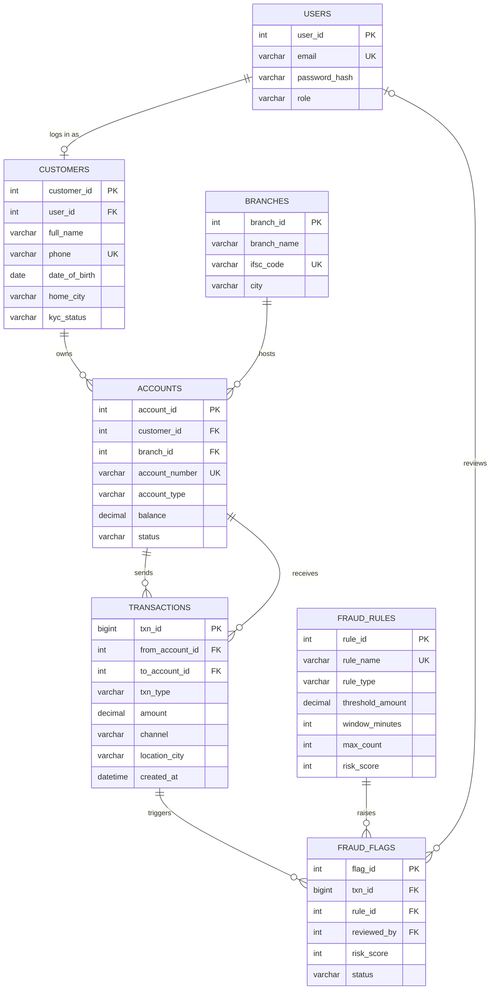

# Database Design Notes: Bank Transaction & Fraud Detection System

Copy and adapt these sections into your project documentation.

## 1. Database choice and justification

| Data | Database | Why |
|---|---|---|
| Users, customers, accounts, branches, transactions, fraud rules, fraud flags | **MySQL (InnoDB)** | Structured, highly relational data. Money movement needs ACID transactions, foreign keys and CHECK constraints so balances and references can never become inconsistent. |
| Fraud alert details, analyst notes, audit log | **MongoDB** | Each alert carries different contextual fields (device, geolocation, burst counts) that vary by rule type; documents hold this without sparse columns or extra join tables. The audit log is append-only and high-volume. |

Rule of thumb used: **facts that must always be correct and consistent live in MySQL; flexible, descriptive, write-heavy context lives in MongoDB.**

## 2. ER diagram (Mermaid: renders on GitHub, or paste into mermaid.live)



## 3. How the two databases connect

- `fraud_alerts.flag_id` in MongoDB equals `fraud_flags.flag_id` in MySQL; `fraud_alerts.txn_id` equals `transactions.txn_id`.
- MySQL is the source of truth. The trigger creates the flag first; the Flask API then writes the matching MongoDB document using the new `flag_id`.
- If the MongoDB write fails, the money data is still correct; the alert simply lacks extra context and the admin page shows the flag without it.

## 4. MongoDB data model

**`fraud_alerts`**: one document per fraud flag. `context` and `analyst_notes` are embedded because they are always read together with the alert and never queried on their own.

```json
{
  "flag_id": 4, "txn_id": 18,
  "rule_name": "Large transaction (>= 50,000)", "risk_score": 70,
  "severity": "high", "status": "confirmed",
  "context": {
    "amount": 90000, "channel": "atm",
    "device": { "type": "atm", "id": "atm-LON-410" },
    "geo": { "city": "London", "country": "UK",
             "location": { "type": "Point", "coordinates": [-0.1276, 51.5072] } }
  },
  "analyst_notes": [ { "by": 1, "note": "Card blocked.", "at": "2026-10-25T10:00:00Z" } ],
  "created_at": "2026-10-25T09:00:00Z"
}
```

**`audit_logs`**: one document per significant event (sign-up, login, deposit, account opened, transfer, flag review, account freeze/unfreeze).

| Collection | Index | Purpose |
|---|---|---|
| fraud_alerts | `{flag_id: 1}` unique | Lookup by MySQL flag; prevents duplicates |
| fraud_alerts | `{txn_id: 1}` | All alerts for a transaction |
| fraud_alerts | `{status: 1, risk_score: -1}` | Open alerts, riskiest first |
| fraud_alerts | `2dsphere` on `context.geo.location` | "Alerts near X" queries |
| fraud_alerts | text on `analyst_notes.note` | Search analyst notes |
| audit_logs | `{at: -1}` | Recent activity feed |
| audit_logs | `{entity: 1, entity_id: 1}` | History of one account or flag |
| audit_logs | `{actor_user_id: 1, at: -1}` | What one user did |

Both collections have `$jsonSchema` validators (required fields, allowed values, numeric ranges).

**Aggregation pipeline used by the dashboard** (`MongoStore.alerts_by_city`):
```
[{ $match: { "context.geo.city": { $exists: true } } },
 { $group: { _id: "$context.geo.city", alerts: { $sum: 1 }, avg_risk: { $avg: "$risk_score" } } },
 { $sort: { alerts: -1 } }, { $limit: 8 }]
```

## 5. Advanced database concepts demonstrated

1. **Transactions:** the `transfer_funds` and `deposit_funds` stored procedures (START TRANSACTION, COMMIT, rollback on any error); the sign-up transaction (user + profile + first account all-or-nothing) and the flag-review transaction in `repo.py`.
2. **Triggers:** `trg_check_fraud` (AFTER INSERT on `transactions`) evaluates the three active rule types for money leaving an account (deposits have no sender and are not scored).
3. **Stored procedures:** `transfer_funds` and `deposit_funds`, with ordered row locking to avoid deadlocks and `SIGNAL` for business-rule errors.
4. **Views:** `v_suspicious_transactions`, `v_account_summary`.
5. **Indexing:** composite indexes on `(from_account_id, created_at)` and `(to_account_id, created_at)`; compare plans with `EXPLAIN` in `db/queries.sql` section C4.
6. **Window functions and subqueries:** running totals per account, correlated subquery for outlier amounts (`db/queries.sql` A4, A8).
7. **NoSQL aggregation, geospatial and text indexes** in MongoDB.

## 6. Integrity and security measures

- MySQL CHECK constraints: non-negative balance, positive amount, valid roles and statuses, valid phone, consistent transaction type versus accounts, valid rule parameters.
- Foreign keys without cascading deletes on accounts and transactions, so history cannot be deleted by accident. (MySQL does not allow CHECK constraints on columns that have `ON DELETE`/`ON UPDATE` actions, so those foreign keys use the default restrict behaviour.)
- Date-of-birth (18+) is validated by the application rather than a CHECK, because MySQL does not allow non-deterministic functions such as `CURDATE()` in CHECK constraints.
- Row locking in a fixed order inside `transfer_funds` prevents lost updates and deadlocks.
- Passwords are stored only as salted PBKDF2-SHA256 hashes; sign-up enforces a password policy (8+ characters, a letter and a number) and an 18+ age check.
- Customers sign up themselves; analyst (admin) accounts can only be created by an operator running `scripts/create_admin.py`, so nobody can promote themselves.
- Sign-up and login attempts are throttled per client.
- Credentials and the session secret live in `.env`, never in source code (`.env` is in `.gitignore`).
- Every state-changing request needs a CSRF token; session cookies are HTTP-only and SameSite=Lax; failed logins are throttled.
- All SQL is parameterised; all user text is HTML-escaped before display; a strict Content-Security-Policy blocks inline scripts.
- Role-based access is enforced on the server for every page and API route, not only in the UI.

## 7. Starting state

`db/schema.sql` creates the structure plus reference data only: 4 branches (customers choose one when they sign up) and the 3 default fraud rules (the trigger reads them, and thresholds can be changed with an `UPDATE`). There are no users, accounts or transactions: customers sign up through the app and the analyst account is created with `scripts/create_admin.py`.
